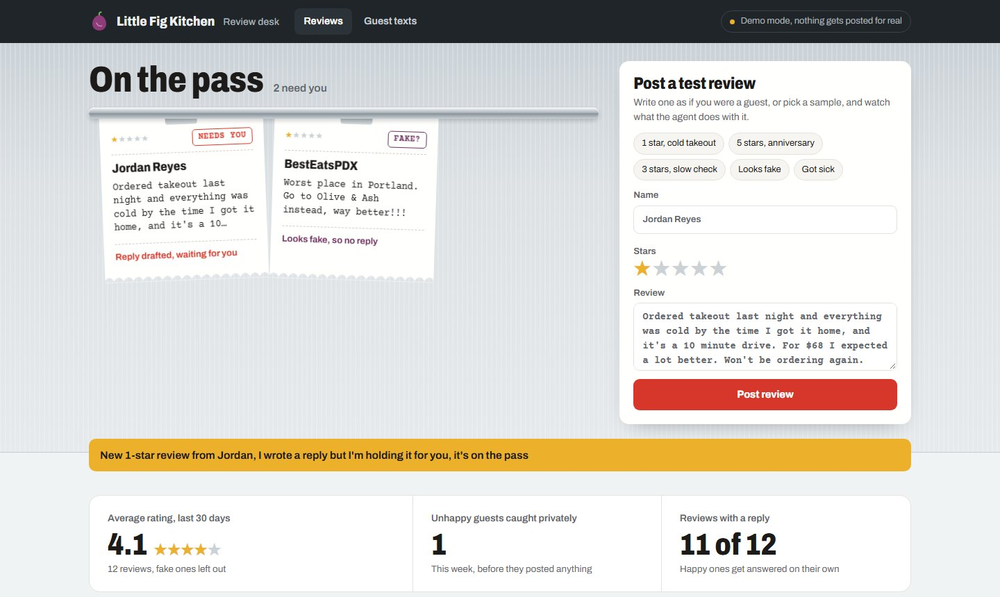
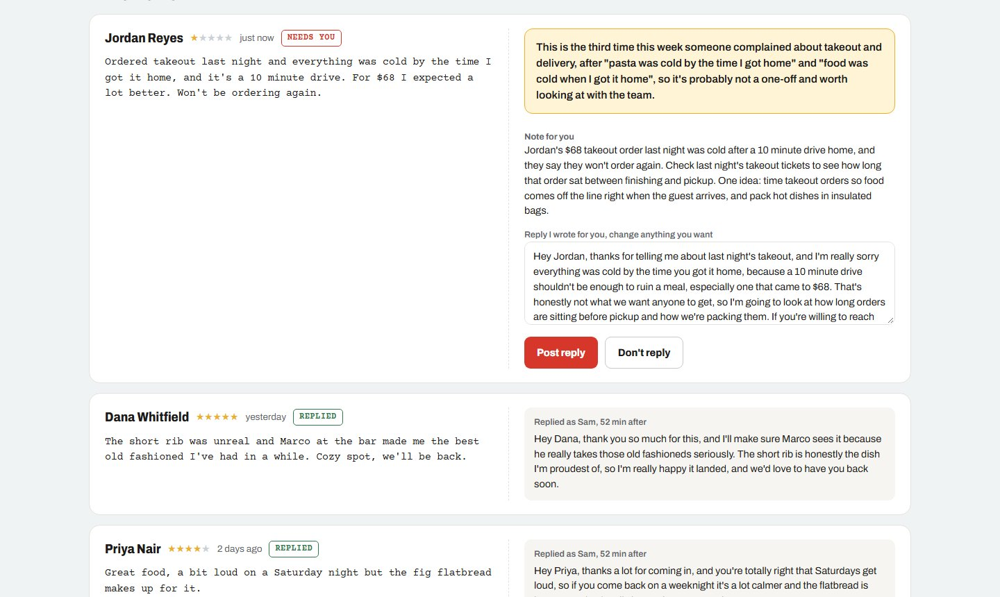
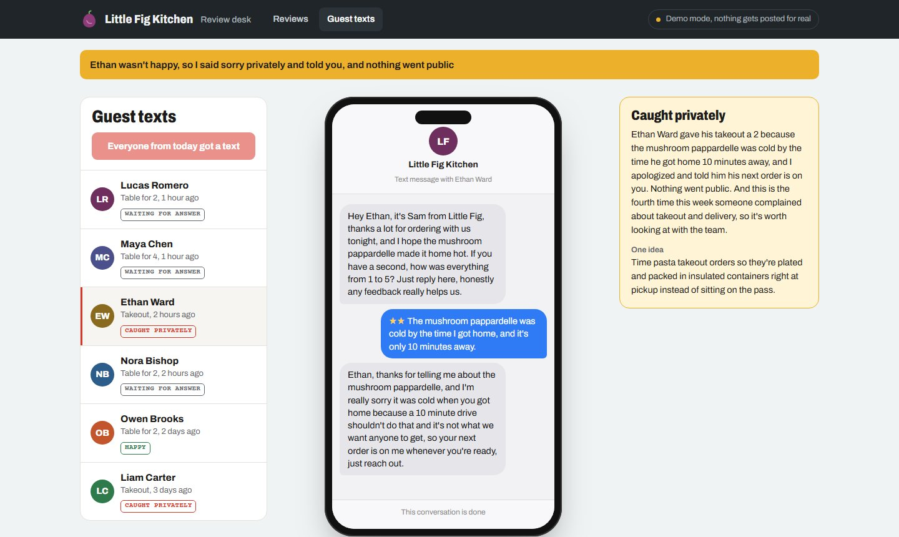

# n8n Review Agent

An n8n agent for a small restaurant that answers every public review in the owner's voice, and texts guests after their visit so the unhappy ones come to the owner first instead of going straight to a review site. It also notices when the same complaint keeps coming back, so the owner can tell a bad night from a real problem.



## What it does

- Reads each new public review with AI and writes a reply that talks about what that guest actually said
- Posts the reply on its own when the review is happy, and holds it for one click when it's a complaint
- Leaves fake looking reviews alone and suggests reporting them
- Never replies publicly to anything about someone getting sick or a legal threat, and tells the owner to reach out personally instead
- Texts guests who came in today and asks how it was. Happy guests get a thank you and the review link, and unhappy ones get an apology right away while the owner gets a private alert
- Counts complaints across public reviews and private texts, so the third "my takeout was cold" in a week gets called out as a pattern



## How it works

The AI reads the review or the text and returns a JSON object through the Messages API: the sentiment, whether it looks fake or is about safety, the topics with a few words from the guest, the reply, and a note for the owner. What happens next is decided in a Code node, not by the AI, so the rules about what gets posted on its own and what waits for the owner stay exact. The pattern check is plain code too, counting negative mentions of the same topic over the last seven days.

The replies follow the owner's voice described in `nodes/_shared.js`, which is the part to change if you want it to sound like you.



## Workflows

| File | What it does |
|---|---|
| `workflows/0-setup.json` | Creates the Data Tables and loads two weeks of demo reviews and guests, plus a reset link |
| `workflows/1-read-reviews.json` | Reads a new review, writes the reply, and decides if it posts or waits |
| `workflows/2-guest-texts.json` | Texts today's guests and handles their answers |
| `workflows/3-pages.json` | The review desk, the guest texts page, and posting or skipping a reply |

## Setup

You need a self-hosted n8n with Data Tables (I built it on n8n 2.48) and an Anthropic API key.

1. Import the four files from `workflows/` into n8n
2. Open the **AI reads the review** node and the **AI reads the answer** node, and pick your Anthropic credential on both
3. Publish all four workflows
4. Create the tables and the demo data:
   ```bash
   curl -X POST http://localhost:5678/webhook/reviews-setup
   ```
5. Open `http://localhost:5678/webhook/reviews`, post one of the sample reviews, then try `http://localhost:5678/webhook/guests`

## What's demo and what's real

In this version new reviews come in through the form on the review desk, and the guest texts stay inside n8n on the phone page, so nothing is posted to a review site and no SMS goes out. To use it for real you'd swap those two ends for your review platform and an SMS provider. Everything in between, the reading, the replies, the rules and the alerts, stays the same.

## Changing it

The workflows are generated from the files in `nodes/`, so edit those and rebuild:

```bash
node build.js
```

`config.json` holds the restaurant name, the owner's name, the city, the review link, and the AI model.

## License

MIT
